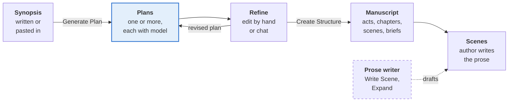

# NovelClanker

A cross-platform Markdown-style editor for writing novels, built with C++20 and Qt 6 Widgets.
Runs on Windows, Linux, and macOS.

A synopsis becomes plans, then the manuscript the author writes:



## Using it

- **File → New Novel...** creates a novel (with Act 1 / Chapter 1 / Scene 1), **File → Open Novel...** opens
  one (select the `.novel` folder). The last novel is reopened on startup; a novel path can also be passed on
  the command line.
- A novel is organised as **acts → chapters → scenes**, shown as a tree on the left. The **+ Act**,
  **+ Chapter** and **+ Scene** buttons above it add a node after the current one (missing parents are created,
  e.g. **+ Scene** on an empty act also adds a chapter). New acts and chapters open for renaming right away.
- Rename with double-click or **F2**, delete with **Del** (with confirmation), reorder with **Alt+Up/Down** or
  by dragging. Drag a scene onto another chapter, or a chapter onto another act, to move it there. The
  **Structure** menu and the tree's right-click menu have the same commands.
- Selecting a scene opens it in the editor. Scenes save automatically 1.5 s after you stop typing, when
  switching scenes, and on exit (**Ctrl+S** saves immediately). The status bar shows word counts for the
  scene, chapter and novel.
- **Spell checking** underlines misspelled words in the scene, synopsis and plan editors (not in code, links or
  URLs). Right-click a word for suggestions, **Add to Dictionary** (your personal word list, for all novels) or
  **Ignore All**. **Edit → Spelling** turns it on or off and chooses the dictionary, saved with each novel: US English
  and UK English are included. For other languages, put a Hunspell `.dic`/`.aff` pair (e.g. from LibreOffice's
  dictionaries) into the folder **Edit → Spelling → Open Dictionary Folder** opens.
- **File → Novel Setup...** holds the book's details for publishing, the fields Amazon KDP asks for when you
  publish an eBook: title, subtitle, series, edition, language, author and contributors, description, keywords,
  publishing rights, explicit content, reading age, categories, publisher and ISBN. Required fields are marked,
  and the window lists what's missing or breaks KDP's rules (e.g. title and subtitle under 200 characters, a
  description of at most 4000). A new novel opens it right away; the window title shows the book's title.
- **File → Export as Markdown...** writes the whole novel to a single `.md` file: acts and chapters become
  `#`/`##` headings, scenes are separated by `* * *`. Small HTML comments that Markdown viewers don't show mark
  each act, chapter and scene (with its title).
- **File → Export as EPUB...** writes an EPUB 3 eBook (accepted by Amazon KDP, Apple Books, Kobo and most
  readers): a title page, one page per chapter with scene breaks, part pages when there is more than one act, and
  a table of contents. Title, author, language, series, description, keywords and ISBN come from Novel Setup.
- **File → Import from Markdown...** creates a new novel from such a file, rebuilding the acts, chapters and
  scenes with their titles and text. Briefs, the synopsis and plans aren't exported, so they start empty. Other
  Markdown works too: `#` starts an act, `##` a chapter, and `* * *`, `***` or `---` a new scene ("Scene 1",
  "Scene 2", ...).

- **Edit → Settings...** sets the address of an [LM Studio](https://lmstudio.ai) server (default
  `http://127.0.0.1:1234`; addresses like `127.0.0.1:1234` or `.../v1` are accepted). The settings view
  connects to the server to list its models (embedding models are left out) in two dropdowns: one for the
  **orchestrator/planner** model and one for the **prose writer** model. Use **Refresh** after starting
  LM Studio's server. Settings are stored per user (QSettings), not in the novel.
- **View → Theme** switches between light and dark mode: **System** follows the operating system, **Light** and
  **Dark** always use that scheme (the same on every platform). **Switch Light/Dark** (**Ctrl+Shift+D**) flips to
  the other one. The choice is remembered.
- **Ctrl+Plus** / **Ctrl+Minus** make the text in the scene, synopsis and plan editors larger or smaller
  (**Ctrl+0** restores the default size; also in the **View** menu). The size is remembered.

- The **Synopsis** tab holds the novel's synopsis: write or paste it there. It is stored exactly as written.
- A novel can have **several plans**, listed on the **Plan** tab with the model that generated each one, or
  "(by hand)". **+ New Plan** adds an empty plan to write yourself, **Delete** removes one (with confirmation),
  and double-clicking a plan's name renames it. Plans can be edited freely and save automatically; editing a
  generated plan doesn't change which model it is recorded as coming from.
- **Create Structure** (Plan tab) builds the manuscript's acts, chapters and scenes from the selected plan,
  reading its `### Act`, `#### Chapter` and `- **Scene N: Title**: ...` lines (common variations are understood;
  only the plan's Structure section is read). Each act, chapter and scene gets the plan's description as its
  **brief**, shown above the editor; scene text starts empty. A new novel's untouched first scene is simply
  replaced; otherwise you choose to add the structure after the existing manuscript or to replace it.
- Under the plan, a **chat box** talks to the model that generated the selected plan (for a plan written by
  hand: this novel's planner model) to refine it. Ask for changes ("give Act 2 a stronger midpoint") and the
  model's revised plan replaces the plan as one edit, so Ctrl+Z in the plan undoes it; questions just get an
  answer. The model always sees the synopsis and the *current* plan, including your own edits. Each plan keeps
  its own conversation (**Clear** forgets it). Enter sends, Shift+Enter starts a new line.
- The **Plan template** dropdown (Synopsis tab) chooses the structural model plans are generated in; a short
  description of the selected template is shown under it, and the choice is saved with the novel:
  - **Three acts (25/50/25)**: a plot-driven novel in three acts with the classic turning points (inciting
    incident, first plot point, midpoint, crisis, climax, resolution).
  - **Inner stages across years**: a character-driven novel spanning many years, planned as the protagonist's
    progression through 5-8 inner stages, in the manner of the stages of grief.
    Parts are `### Stage N: <name>`, every scene carries a time marker (season, birthday, signs of ageing,
    changing technology or surroundings) instead of "years later" summaries, and a bleak or unresolved ending
    is kept as the synopsis has it.
- Next to **Generate Plan**, the **Planner model** dropdown chooses the model for this novel's plans. It lists
  the LM Studio server's models (**Refresh** fetches them again); "Settings default" uses the planner model
  from Edit → Settings, and any other choice overrides it. The choice is saved with the novel.
- **Generate Plan** (on the Synopsis tab) asks the planner model to turn the synopsis into a **new** plan;
  existing plans are never replaced. The plan streams into the Plan tab as it is written (**Stop** keeps what
  has been written so far). Reasoning ("thinking") output from reasoning models is left out. If generation
  fails or produces nothing, no plan is added. If the model hits its length limit the plan view says so; raise
  the model's context length in LM Studio (a full plan needs roughly 8-16k tokens).

- Above the scene editor, the **prose writer** model (chosen in Edit → Settings) writes text, at the length
  chosen in **Length** (200, 500, 1000 or 2000 words; the choice is remembered):
  - **Write Scene** writes the whole scene from its brief (or its chapter's brief). The model also sees the
    synopsis, the act and chapter, the end of the previous scene (so it continues from there) and the next
    scene's brief (so it stops before it). If the scene already has text you are asked before it is replaced.
  - **Expand** rewrites the selected text (**Expand Selection**), or the whole scene if nothing is selected,
    as a longer passage, keeping its events and the text around it. Write a few sentences, expand them to
    200 words, then select the result and expand it to 500, and so on.
  - Models count words poorly and some never stop on their own, so a request is ended once the text passes the
    chosen length by a quarter (at least 50 words), cutting at the end of the last whole sentence. Models also
    tend to go on and rewrite the text that follows an expanded passage; when the answer shares a run of five
    words with that text, it is cut at the start of that sentence (and the request is stopped).
  - The text streams into the editor; **Stop** keeps what has been written so far. Each generation is one
    undo step, so **Ctrl+Z** brings back the previous text. If the request fails, the text is left unchanged.

### The plan prompt

The prompts are in `src/PlanPrompt.cpp`, one per template; the three-act one is described here. It asks the model to act as a developmental editor and produce a plan
that stays faithful to the synopsis. The model first lays out a *story spine* (the synopsis's key events and
turning points in order, each assigned to an act) and then builds three acts from it (roughly 25/50/25% of the
chapters), giving every scene a POV character, goal, conflict and outcome. It lists its own inventions as open
questions. The plan has a fixed Markdown shape that mirrors the app's acts, chapters and scenes:

```
# <Working title>
## Premise / ## Genre, tone and point of view / ## Themes / ## Characters / ## Settings
## Story spine
## Structure
### Act 1: <title>
#### Chapter 1: <title>
- **Scene 1: <title>**: POV: <character>. Setting: <place, time>. <Goal, conflict and outcome.>
## Open questions
```

## Storage

A novel is a [RocksDB](https://rocksdb.org) database folder (conventionally named `*.novel`) in which every
scene's text is a separate entry. The keys and the format version are described in
[docs/storage-format.md](docs/storage-format.md).

## Requirements

- A C++20 compiler (MSVC 2022+, GCC 11+, Clang 14+ / Apple Clang)
- CMake 3.23+
- [Conan 2](https://conan.io) (`pip install conan`)
- Linux only: Qt needs X11/OpenGL system packages. Let Conan install them by adding
  `-c tools.system.package_manager:mode=install` to `conan install`.

## Building

The first `conan install` builds Qt and RocksDB from source (ConanCenter has no matching prebuilt binaries),
which can take an hour or more. The result is cached in `~/.conan2`, so later installs are fast.

### Windows (MSVC + Ninja)

**Quick way:** run `build.bat` (double-click it, or run it in a terminal). It checks the tools, installs the
dependencies with Conan, builds, and puts a self-contained copy in `dist\`: double-click `dist\NovelClanker.exe`,
or copy the whole `dist` folder to another PC. `build.bat test` also runs the tests first. The first run builds Qt
and RocksDB from source and can take an hour; later runs take a minute or two. It needs Visual Studio 2026 Build
Tools (C++ workload), CMake 3.23+ and Conan 2 (`pip install conan`). If your user folder contains a space, set
Conan's storage path first (see below); `build.bat` stops with instructions if it isn't set.

The manual steps, which `build.bat` runs for you:

A ready-made profile is in `profiles/windows-msvc` (Visual Studio 2026 / MSVC 19.5, C++20, Ninja).
Edit `compiler.version` if you use another Visual Studio version (194 = VS 2022). The profile also builds
RocksDB with UTF-8 file names so novels can live in folders with non-ASCII names.

```bat
conan install . -pr:a ./profiles/windows-msvc --build=missing

:: Ninja needs the MSVC environment; conanbuild.bat activates it (vcvars)
build\Release\generators\conanbuild.bat
cmake --preset conan-release
cmake --build --preset conan-release
```

Each build copies the Qt DLLs and plugins next to the executable (via `windeployqt`), so
`build\Release\NovelClanker.exe` starts directly: double-click it, or run it from an IDE or debugger.

If your Windows user folder contains a space (e.g. `C:\Users\First Last`), move Conan's package storage to a
path without spaces first, since several dependency build tools break on spaces. Add this to
`~/.conan2/global.conf`:

```
core.cache:storage_path = E:/conan2/p
```

### Linux / macOS

**Quick way on Linux:** run `./build.sh` (`./build.sh test` also runs the tests). It installs the dependencies
with Conan, builds in `build/linux/Release` (so a Windows build in the same checkout isn't touched), and puts a
self-contained copy in `dist/`: start `dist/NovelClanker`, or copy the whole `dist` folder to another machine. It
needs a C++20 compiler (g++ 11+) and Python 3 with venv. If CMake 3.23+, Conan 2 or Ninja are missing or too old,
it installs them into a private environment in `build/linux-tools`, not system-wide. Missing X11/OpenGL
development packages are installed with `sudo` when you run it from a terminal (you'll be asked for your
password); otherwise it lists them. Tested on Ubuntu 22.04.

`dist/` contains the app, the Qt libraries (`lib/`) and Qt's plugins (`plugins/`). It uses the desktop's own
system libraries: glibc, X11/xcb (including `libxcb-cursor0`, which Qt 6.5+ needs), OpenGL and fontconfig with the
system font configuration (`/etc/fonts/fonts.conf`). It runs on distributions as new as, or newer than, the one it
was built on.

Manual steps (Linux and macOS):

```sh
conan profile detect            # one-time: create a default profile for your compiler
conan install . -s compiler.cppstd=20 --build=missing
cmake --preset conan-release
cmake --build --preset conan-release
./build/Release/NovelClanker      # macOS: open build/Release/NovelClanker.app
```

Run the tests with `ctest --test-dir build/Release --output-on-failure`. They're self-contained: the LM Studio
tests use a fake server and the window tests run headless (no window appears). Optional checks against a real
LM Studio (`NOVELCLANKER_LIVE_LMSTUDIO=http://127.0.0.1:1234`):

- `settings_test` also lists the server's models in the settings view.
- `chat_test` with `NOVELCLANKER_LIVE_PLANNER_MODEL=<model id>` also generates a plan from a sample synopsis
  (written to `NOVELCLANKER_LIVE_PLAN_OUT` if set). With `NOVELCLANKER_LIVE_REFINE_PLAN=<plan file>` and
  `NOVELCLANKER_LIVE_REFINE_REQUEST="..."` it refines that plan through the plan chat instead.
  `NOVELCLANKER_LIVE_TEMPLATE=<template id>` (`three-act`, `inner-stages`) and
  `NOVELCLANKER_LIVE_SYNOPSIS_FILE=<file>` choose the template and replace the sample synopsis.
- `prose_test` with `NOVELCLANKER_LIVE_PROSE_MODEL=<model id>` expands a one-sentence sketch to 200 and 500 words,
  expands an opening sentence that a long paragraph follows (reporting repeats of that paragraph;
  `NOVELCLANKER_LIVE_OPENING_ONLY=1` runs only this) and writes a 500-word scene, printing the word counts
  (`NOVELCLANKER_LIVE_RUNS=<n>` repeats each, `NOVELCLANKER_LIVE_SHOW=1` prints the text).

EPUB exports are also checked with [EPUBCheck](https://www.w3.org/publishing/epubcheck/), the validator eBook
stores use, when it is available: install Java, unpack an EPUBCheck release into `build/tools/epubcheck/` (or set
`EPUBCHECK_JAR` to its `epubcheck.jar`) and configure again. The `epubcheck` test then validates the test books and
fails on any error or warning. `epub_test` saves its books to a folder named by `NOVELCLANKER_EPUB_OUT`.

To see how plans are read into acts/chapters/scenes, run `planstructure_test` with
`NOVELCLANKER_PARSE_PLAN=<plan file>`, or with `NOVELCLANKER_PARSE_NOVEL=<novel folder>` to check every plan in
a novel (it flags briefs that swallowed a heading). Use a copy of the novel: opening it can write RocksDB
housekeeping files.

For a Debug build, run `conan install` again with `-s build_type=Debug` and use the `conan-debug` presets.

### Requirements (StrictDoc)

The software requirements are in [docs/requirements.sdoc](docs/requirements.sdoc), managed with
[StrictDoc](https://strictdoc.readthedocs.io). Tests point at the requirements they verify with comments such as
`// @relation(FR-PRS-10, scope=function)`; StrictDoc links each requirement to those test functions. Install it
once into a virtual environment (Python 3.12):

```powershell
py -3.12 -m venv .venv
.venv\Scripts\python -m pip install -r tools/requirements-docs.txt
```

Then export static HTML (open `build/strictdoc/html/index.html`; the traceability matrix and source coverage
pages show which requirements have tests), or browse and edit in StrictDoc's web UI:

```powershell
.venv\Scripts\strictdoc export . --output-dir build/strictdoc
.venv\Scripts\strictdoc server .
```

When StrictDoc is installed in `.venv` at configure time, CTest also runs a `requirements` test that fails if the
document is malformed or a `@relation` marker names a requirement that doesn't exist. Requirement text is
reStructuredText; each requirement has `PRIORITY` (Must/Should/Could) and `STATUS` (Implemented/Planned).

### Distributable app

```sh
cmake --install build/Release --prefix dist
```

On Windows, `dist/` becomes a self-contained folder (Qt and the MSVC runtime included) that runs on machines
without any SDKs. On macOS, the install step runs `macdeployqt` on `dist/NovelClanker.app` to bundle Qt (not yet
tested). Linux packaging (e.g. AppImage) isn't set up yet; run the binary from the build tree there.

## Project layout

See [docs/project-layout.md](docs/project-layout.md) for what lives where in the repository.

## License

Copyright (C) 2026 The NovelClanker authors

NovelClanker is free software: you can redistribute it and/or modify it under the terms of the GNU General
Public License as published by the Free Software Foundation, either version 3 of the License, or (at your
option) any later version.

NovelClanker is distributed in the hope that it will be useful, but WITHOUT ANY WARRANTY; without even the
implied warranty of MERCHANTABILITY or FITNESS FOR A PARTICULAR PURPOSE. See the GNU General Public License for
more details.

You should have received a copy of the GNU General Public License along with NovelClanker (see
[LICENSE](LICENSE)). If not, see <https://www.gnu.org/licenses/>.

NovelClanker uses [Qt](https://www.qt.io) under the GNU LGPL v3 and [RocksDB](https://rocksdb.org) under the
Apache License 2.0 (RocksDB is dual-licensed with GPLv2).
The spelling dictionaries come from LibreOffice's dictionaries: US English under the SCOWL license (BSD-style)
and UK English under the GNU LGPL; see [dictionaries/SOURCE.md](dictionaries/SOURCE.md).

The self-contained `dist` folder made by `build.bat`, `build.sh` or `cmake --install` contains `LICENSE.txt`,
`THIRD-PARTY-NOTICES.txt` (every bundled library with its version, license and homepage, generated by
`conanfile.py` from the Conan dependency graph) and each library's license files in `licenses/<name>/`.
